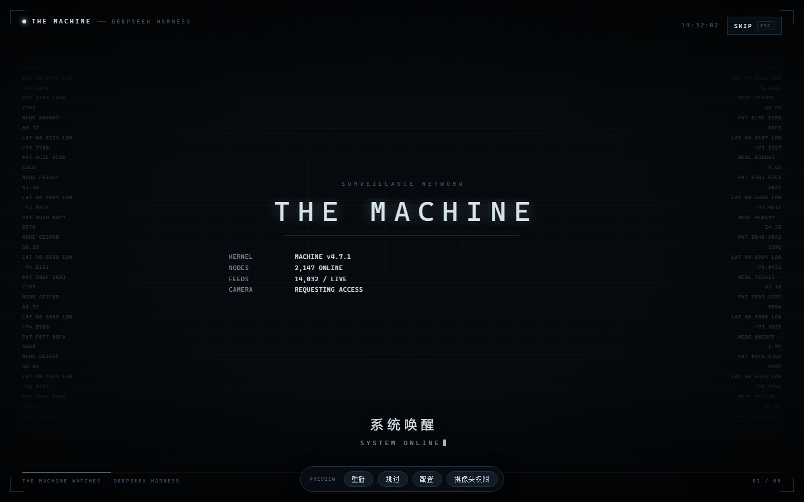
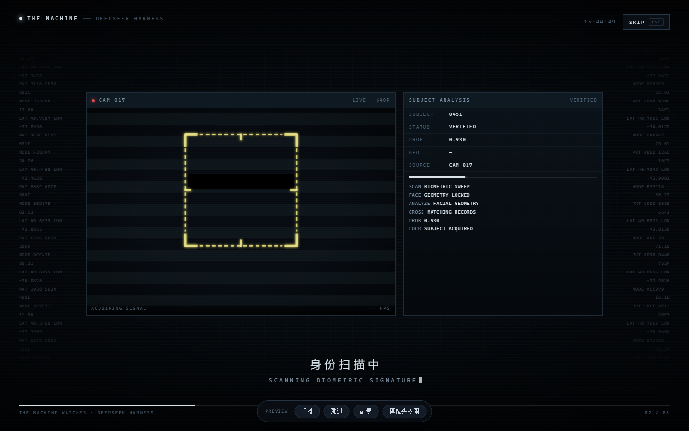
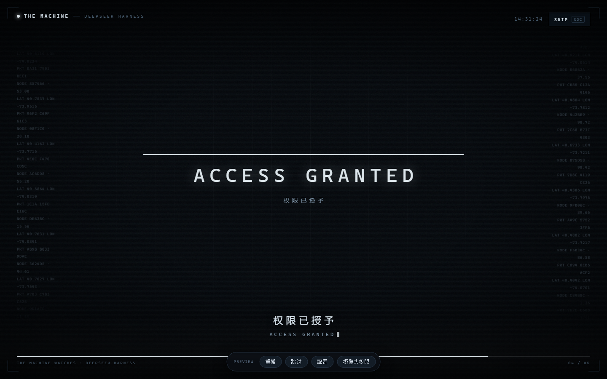
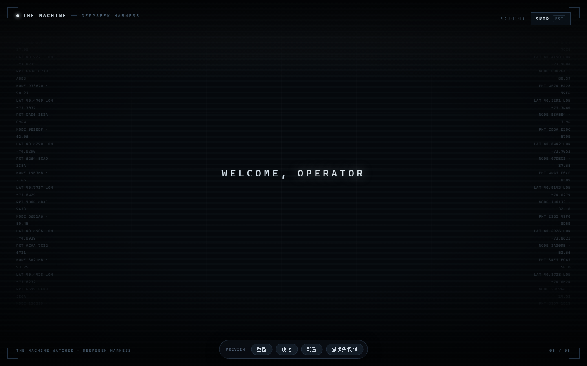

<div align="center">

# dsh-startup-machine

**给 DeepSeek Harness 桌面端做的「疑犯追踪 / THE MACHINE」风格开机动画**

五幕序列 · 摄像头人脸锁定 · 478 点人脸网格 · 眼部黑条 · 五幕时长全部可调


</div>

---


> [!IMPORTANT]  
> **这个项目会修改 DSH 桌面端的主程序 `app.asar`。** 它不是纯插件。
>
> 原因：Electron 主进程把媒体权限写死成「只放行麦克风」，视频请求在到达 Windows 之前就被拒了，  
> 而且没有官方开关。本项目用**等长字节替换**把这一行放开，并在每次登录时做一次校验。  
> 完整说明见 [⚠️ 它到底改了什么](#它到底改了什么)。介意动主程序的话，可以只用  
> `-SkipCameraPatch` 装纯插件模式（动画照播，第二幕用模拟头像）。

---

## 目录

- [它是什么](#它是什么)
- [参考项目](#参考项目)
- [效果](#效果)
- [快速开始](#快速开始)
- [⚠️ 它到底改了什么](#它到底改了什么)
- [卸载与回滚](#卸载与回滚)
- [配置](#配置)
- [工作原理](#工作原理)
- [已知限制](#已知限制)
- [开发与测试](#开发与测试)
- [许可与致谢](#许可与致谢)

---

## 它是什么

一个 DSH（DeepSeek Harness）桌面端插件 + 一小段部署脚本。启动 DSH 时先播一段 7.5 秒的五幕开机序列：

| 幕          | 画面                           | 时长（默认） |
| ---------- | ---------------------------- | ------ |
| 01 BOOT    | 纯黑标题卡，一句话压在全黑上               | 1.2 s  |
| 02 SCAN    | **实时摄像头** + 黄色取景框跟随人脸 + 眼部黑条 | 3.0 s  |
| 03 MATCH   | 档案卡，用当前帧做「档案照」，眼部同样打码        | 1.4 s  |
| 04 ACCESS  | 授权条 + `ACCESS GRANTED`       | 1.2 s  |
| 05 HANDOFF | 欢迎语，淡出露出主界面                  | 0.7 s  |

右下角随时可以 `SKIP`（Esc / 空格 / 回车也能跳过）。

### 参考项目

这个项目的视觉不是凭空来的，三个开源项目定了它的样子（都是 MIT，文末有归属说明）：

| 项目                                                                                      | 它是什么                                                                               | 这里用了什么                                                                            |
| --------------------------------------------------------------------------------------- | ---------------------------------------------------------------------------------- | --------------------------------------------------------------------------------- |
| [**rosehahah/the-machine**](https://github.com/rosehahah/the-machine)                   | 《疑犯追踪》The Machine 的开源复刻：机器视角跑在自己的摄像头上，框住它看到的每个人、把你认成 `ADMIN`、认出武器与跌倒、发一个号码，外加六页控制台 | **取景框的绘制规则**移植自它的 `web/hud.js` —— 框必须是方的、框住头肩而不是整个人                               |
| [**Crispsormd/the-machine-windows**](https://github.com/Crispsormd/the-machine-windows) | 上面那个的 Windows 社区移植：Camo 接 iPhone、DirectShow 采集、360p/540p/720p 三档、中文路径兼容            | 人脸识别的**叙事节奏**与 HUD 的**信息结构**：档案卡、状态机（`SCANNING` → `ANALYZING` → `VERIFIED`）、号码式编号 |
| [**yuqisun/dsh-theme-machine**](https://github.com/yuqisun/dsh-theme-machine)           | 同一个剧的 DSH 皮肤：token 覆盖层 + HUD 网格 + 右下角实时遥测面板                                        | **视觉基线**：`#05080c` 深蓝黑底、`#dce5ea` 机器白、全大写 + 0.2–0.3em 宽字距、四角括号锁定框、扫描线、HUD 网格      |

界面是本项目自己实现的（`splash.css` + `hud-draw.js` + `splash.js`），其中只有取景框绘制是从  
rosehahah/the-machine 的 `web/hud.js` 移植的，其余是参照上面三个项目的观感重新写的。

## 效果

<p align="center">  
    
    
</p>  
<p align="center">  
    
    
</p>

> 截图取自**早期版本**的独立预览页（旧文案 `SYSTEM ONLINE`、旧默认身份 `0451`），  
> 当前版本已换成新文案与 `Low_Entropy` / `114514`，版式不变。  
> 自己出图：`plugin\preview.cmd` 会起本地预览页（`127.0.0.1:8917`，带「重播 / 跳过 / 配置」条）。

---

## 快速开始

**前提**：Windows 10/11 + DSH 桌面端（Electron 版）。摄像头可选 —— 没有也能演。

```text
1. 解压到任意目录（路径别带空格，例如 C:\dsh-plugins\dsh-startup-machine-1.2.5）
2. 双击  安装.cmd
3. 完全退出 DSH（关窗口不算，要退出所有进程），再启动
```

安装器会打印它做了什么；结束时提示 `NEXT: fully quit DeepSeek Harness ...`。

> 从源码装也一样：`git clone` 后进入仓库根目录跑 `install.ps1`（脚本用 `$PSScriptRoot` 定位文件，  
> 不需要额外的构建步骤 —— 这个项目没有打包流程，`plugin/` 就是最终产物）。

更细的部署步骤、逐条验证清单和排错表见 **[部署手册](docs/deploy-windows.md)**。

装完在 **设置 → 启动动画 · MACHINE** 里调，面板底部会显示版本号（直接读 `plugin/package.json`）。

### 可选参数

```powershell
# 只装插件，不动 app.asar（第二幕会退回模拟头像）
powershell -NoProfile -ExecutionPolicy Bypass -File install.ps1 -SkipCameraPatch

# 不装登录守护（DSH 升级后需要手动重打补丁）
powershell -NoProfile -ExecutionPolicy Bypass -File install.ps1 -SkipGuard

# 强制用包内出厂配置覆盖已有配置
powershell -NoProfile -ExecutionPolicy Bypass -File install.ps1 -ForceConfig
```

---

## 它到底改了什么

开工之前请先看这一节。三条都写在这里，而不是藏在代码里。

### 1. 改 `app.asar` 的一行（等长替换）

DSH 主进程里两处媒体权限判断：

```diff
- ... && details.mediaType === "audio" && ...
+ ... && (details.mediaType || 1)      && ...

- ... && details.mediaTypes.length === 1 && details.mediaTypes[0] === "audio"
+ ... && details.mediaTypes.length >= 1
```

等长替换，所以 asar 的头部、偏移、每个 entry 的长度全不变（在 1.2.4 时代的某个 DSH 构建上实测：  
182,434,783 字节里只有这 2 处、共 65 字节不同，头部完全一致）。**主窗口校验、主框架校验、  
`dsh-app://app` 来源校验都保留**——摄像头不会给任意 iframe 拿到。

已知代价：

- `app.asar` 内部声明的 SHA-256 会与内容不符（Windows 版 Electron 默认不校验，不影响运行；  
  但任何完整性审计都会把这次改动标出来）。
- DSH 升级会覆盖这个文件，所以要靠下面的守护重打。  
  |  |  |  |  
  | --- | --- | --- |
- 权限放开得比「只放视频」宽（`(details.mediaType || 1)` 对任何 media 类型都为真）。  
  要收窄成只放 `video` 是等长替换、成本几乎为零 —— 这是已知的松紧取舍，欢迎 PR。

### 2. 登录守护（会自启）

启动文件夹里放一个 `DSH-Camera-Patch-Guard.vbs`，每次登录**静默**检查补丁是否还在，被 DSH 升级  
覆盖了就自动重打。

> 注意：重打补丁要写 `app.asar`。如果 DSH 装在 `C:\Program Files` 这类需要管理员的位置，  
> 登录时是普通用户权限，重打会失败（守护会在 `guard.log` 里记一条 `re-apply failed`，  
> 然后跳过）。装在 `D:\` 等可写目录下才会真正自动生效；否则升级后手动跑一次  
> `python camera-patch\patch_camera.py --apply`（用管理员终端）。

1.2.5 起做了加固：

- 守护脚本装在 **`<DSH 安装目录>\resources\dsh-startup-machine-guard\`**（与 `app.asar` 同一 ACL），  
  不再是用户目录里那份谁都能改的副本；装不进去才回落到 `~\.dsh\camera-patch` 并**明确警告**。
- 装的时候写 `guard-manifest.json` 记录脚本 SHA-256；VBS 启动前用 `certutil` 校验，  
  **哈希不符就静默退出**（不执行）。
- 安装时删除旧版留在用户目录里的脚本副本。

性质上这仍然是「用户不可见的自启 + 持续修改第三方程序」。目的良性，但形态和恶意软件的  
持久化手法重合，**可能被杀软/EDR 报行为**。不想有这个的话用 `-SkipGuard`。

### 3. 不动的东西（可以核对）

- **不联网**：没有任何外发请求。MediaPipe 模型和 wasm 随包，本地推理。
- **不存画面**：摄像头流只画在本地 canvas，播完/跳过立刻 `stop()` 所有 track，不落盘、不上传。
- **不动隐私开关**：不改 Windows 摄像头权限、不改显卡首选项、不碰 BIOS。
- 账号、会话、聊天记录都不碰；卸载不删你的配置文件。

---

## 卸载与回滚

```powershell
# 移除插件 + 登录守护（保留 app.asar 补丁和你的配置）
powershell -NoProfile -ExecutionPolicy Bypass -File uninstall.ps1

# 连 app.asar 一起还原（先完全退出 DSH）
powershell -NoProfile -ExecutionPolicy Bypass -File uninstall.ps1 -RestoreAsar
```

也可以双击 `卸载.cmd`（参数是透传的：`卸载.cmd -RestoreAsar`）。

还原只认**安装时写过清单**的备份：`patch_camera.py --apply` 会生成 `app.asar.camera-backup.json`  
（记录备份文件名、大小、SHA-256），`-RestoreAsar` 只还原与清单完全一致的那份。哈希不匹配  
（疑似被投毒）一律拒绝，`-Force` 也不放行；没有清单的旧备份默认拒绝，可用 `-Force` 强制。

备份在 DSH 安装目录的 `resources\` 下，文件名形如 `app.asar.bak-camera-20261028-120000`，  
**只保留最近一份**（asar 约 180 MB，以前每升级一次就多留一整份）。

---

## 配置

配置文件：`%USERPROFILE%\.dsh\dsh-startup-machine.json`，**72 项**，原子写入、UTF-8 无 BOM。  
面板里点「恢复默认」= 回到出厂外观（出厂 `config` 与代码里的三处 `DEFAULTS` 逐字段一致）。

| 组       | 能调什么                                         |
| ------- | -------------------------------------------- |
| 播放      | 启用、`always`/每次会话/每天一次、全局倍速、强制跳过时限            |
| 音效      | 开关、音量（扫频 / 锁定双音 / 授权和声，WebAudio 现场合成，不带音频文件） |
| 摄像头     | 开关、清晰度（320/640/1280）、镜像、饱和度/对比度/亮度、追踪开关与灵敏度  |
| 眼部黑条    | 开关、块数/宽度/高度/偏移/缝隙、厚度、跟随眼睛、平滑、抖动              |
| 身份 / 文案 | 名字、编号、分类、置信度、权限等级、每幕中英文文案、品牌名、页脚             |
| 视觉      | 锁定框样式（剧里那六种固定配色）、主色/警告色/告警色                  |

> 1.2.4 起**没有人声播报**：Web Speech API、音色/语速/音调/`voiceWait` 这些配置项、面板里的  
> 语音分组、`API.speak()` 全部删除，幕推进只看幕长。旧配置里的 `voice*` / `*Say` 键会在下次  
> 保存时被自动丢弃。

---

## 工作原理

```text
DSH 桌面端 (Electron)
├─ resources/app.asar
│   ├─ lib/main.js        媒体权限（本项目等长替换这 2 处）
│   └─ index.html         ← Host 侧注入遮罩 + 6 个 script
└─ <DSH_HOME>/plugin-sources/dsh-startup-machine/   插件
    ├─ lib/index.js       Host 侧：路由 / 注入 / 配置持久化
    ├─ lib/client.js      设置页「启动动画 · MACHINE」
    ├─ lib/splash.js      运行时：五幕时间轴
    ├─ lib/face-track.js  取景框追踪（肤色连通域 + 质心）
    ├─ lib/face-track-gl  同一个算法的 WebGL 后端
    ├─ lib/face-landmark  478 点网格（MediaPipe，本地推理）
    ├─ lib/hud-draw.js    取景框 / 标签 / 黑条绘制
    └─ lib/eye-track.js   眼位检测

旁路
├─ camera-patch/patch_camera.py           打 / 查补丁（可单独跑）
└─ 启动文件夹\DSH-Camera-Patch-Guard.vbs  登录时校验哈希 → 调守护脚本
```

- **插件**只是一个普通的 DSH 插件：往 profile 的 `package.json` 注册依赖 + bundle，建一个  
  `node_modules` junction，然后由 Host 侧往 `index.html` 注入遮罩和脚本。
- **摄像头补丁**是独立的 Python 脚本（用 DSH 自带的 Python 运行时跑），也可以单独用：  
  `python patch_camera.py --check` / `--apply` / `--asar <path>`。
- **追踪**有三级降档：MediaPipe GPU delegate → CPU delegate → 肤色连通域。跑不动就降档，  
  动画不会被拖卡（虚拟显卡、远程桌面上会看到 `MESH` 变 `FACE / GEOMETRY LOCKED`）。

---

## 已知限制

- **仅 Windows**。媒体权限由 Electron 主进程控制，别的平台没有这个问题。
- 追踪精度有边界：戴粗框/反光眼镜、侧脸超 30–40°、强逆光、脸部大面积遮挡时点位会偏，  
  可以把「黑条跟随眼睛」关掉退回固定比例。
- 虚拟显卡/远程桌面下 GPU delegate 可能每帧 1 秒以上，会自动降档，属于设计行为。
- 模拟头像是一张静态图（加了冷调 + 细噪点），只负责「有画面可锁」，不模仿真人反应。
- 字体依赖系统已装 `HarmonyOS Sans SC`；没装会回落 Noto Sans SC / 思源 / 雅黑，排版不塌但字重会变。
- DSH 升级会覆盖 `app.asar`；有守护会自动重打，但没有守护时需要手动跑一次 `--apply`。
- 非官方项目，与 DeepSeek 无关。

---

## 开发与测试

插件本体零第三方依赖，Node ≥ 20。

```bash
cd plugin
npm test          # 等价于依次跑下面 7 个
node test/smoke.mjs           # 105 项：契约、配置一致性、回归
node test/hud-draw.mjs        #  36 项：取景框/黑条绘制
node test/panel.mjs           #  10 项：设置面板
node test/eye-track.mjs       #  14 项：眼位检测
node test/face-track.mjs      #  13 项：追踪算法
node test/face-landmark.mjs   #  14 项：478 点网格封装
node test/lint-globals.mjs    #   8 项：未声明变量扫描
```

合计 **200 项**，全部零依赖、不打 DOM（面板用一个极小的假 React 跑）。改完记得跑一遍——  
`smoke` 里有几项是「文档与代码同步」的断言（版本号、配置字段数、测试项数），改多了它会拦你。

单看效果不用装 DSH：`plugin\preview.cmd` 会在 `127.0.0.1:8917` 起一个静态服务并打开预览页  
（`getUserMedia` 需要安全上下文，所以不能直接双击 html）。

仓库结构：

```
.
├── README.md                            本文件
├── LICENSE                              MIT
├── 安装.cmd / 卸载.cmd / 重启DSH.cmd     用户入口
├── install.ps1 / uninstall.ps1           安装/卸载逻辑（纯 ASCII）
├── docs/deploy-windows.md               完整部署手册（验证清单 / 排错 / 回滚）
├── 安装说明-给AI.md                      给「替人安装的助手」的执行说明
├── plugin/                               插件本体
│   ├── lib/  preview/  test/  screenshots/
│   └── assets/mp/                        MediaPipe 运行时 + 模型（约 13 MB，随包离线）
├── camera-patch/                         摄像头权限补丁 + 登录守护
├── config/dsh-startup-machine.json       出厂配置（= 代码默认值）
└── CHANGELOG.md / VERSION.txt
```

---

## 许可与致谢

本项目代码以 **MIT** 发布，见 [LICENSE](LICENSE)（npm 包内另有一份 `plugin/LICENSE`）。

[参考项目](#参考项目)里的三个仓库也都是 MIT。本项目与它们没有隶属或官方合作关系，  
界面代码是自己写的，只有取景框绘制是移植的；如果这些上游项目帮到了你，请去给它们点星。

- 人脸网格与推理运行时 [MediaPipe Tasks Vision](https://github.com/google-ai-edge/mediapipe)（Apache-2.0，  
  许可原文随包在 `plugin/assets/mp/`）
- 字体不随包分发，优先使用系统已装的 HarmonyOS Sans SC
- 截图里的模拟头像是一张普通照片，仅用于「没有摄像头」时的占位

> THE MACHINE / Person of Interest 的相关名称与视觉风格属于原剧方；本项目是非商业同人实现，  
> 与剧方、与 DeepSeek 均无隶属关系。
