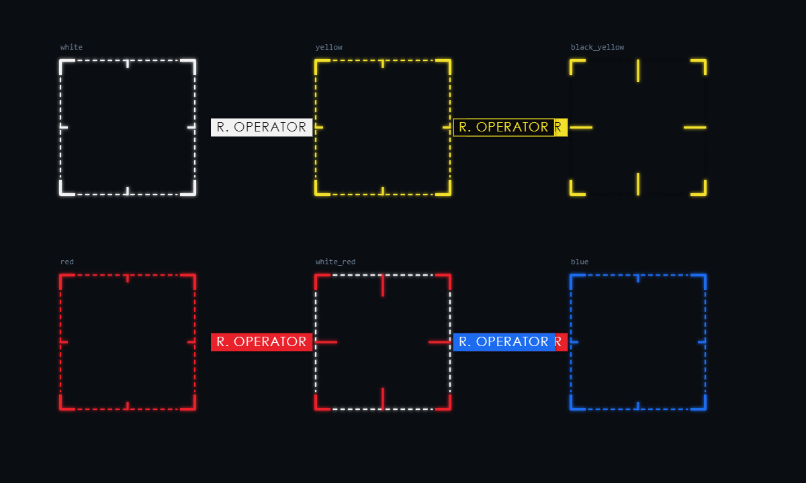

# dsh-startup-machine

DeepSeek Harness（`dsh`）的启动动画插件 —— **THE MACHINE / 疑犯追踪** 风格的五幕开机序列。  
默认 **7.5 秒**，随时可一键跳过。字幕、每一幕时长、摄像头清晰度、眼部黑块马赛克  
全部在设置页可改，改完立即生效。（1.2.4 起没有人声播报，只保留 WebAudio 音效。）

视觉基线取自 [`yuqisun/dsh-theme-machine`](https://github.com/yuqisun/dsh-theme-machine)：  
深蓝黑底（`#05080c`）、机器白（`#dce5ea`）作为唯一「数据色」、全大写 + 0.2–0.3em 宽字距、  
四角括号锁定框、扫描线与 HUD 网格。  
取景框的绘制规则（框是方的、框住头肩而不是整个人）移植自  
[`rosehahah/the-machine`](https://github.com/rosehahah/the-machine) 的 `web/hud.js`；  
人脸识别的叙事与 HUD 信息结构参考  
[`Crispsormd/the-machine-windows`](https://github.com/Crispsormd/the-machine-windows)。

| 01 系统唤醒 | 02 身份扫描 |
| ------- | ------- |
|         |         |

| 04 权限授予 | 05 揭幕 |
| ------- | ----- |
|         |       |

六种框样式（`white` / `yellow` / `black_yellow` / `red` / `white_red` / `blue`）：



> 截图是无头浏览器拍的，第二幕画面里是噪点（没有真摄像头），框与黑条是真实渲染。
> 真机上就是你自己的脸 + 那条黑条。

---

## 播放序列（默认 7.5 秒）

| #  | 幕    | 时长   | 画面                                            | 需要操作 |
| -- | ---- | ---- | --------------------------------------------- | ---- |
| 01 | 系统唤醒 | 1.2s | 厂牌 + 启动自检日志 + 扫光                              | 自动   |
| 02 | 身份扫描 | 3.0s | **摄像头画面** + 四角锁定框 + 扫描线 + **眼部黑块马赛克** + 右侧遥测栏 | 自动   |
| 03 | 档案比对 | 1.4s | 档案卡：用画面当前帧做「档案照」，眼部照样打码                       | 自动   |
| 04 | 权限授予 | 1.2s | ACCESS GRANTED + 授权条                          | 自动   |
| 05 | 揭幕   | 0.7s | WELCOME, {身份} → 淡出露出主界面                       | 自动   |
| —  | 跳过   | —    | 右上角 SKIP，或 Esc / 空格 / 回车                      | 随时   |

第二幕的识别状态机按「疑犯追踪」的规矩走：

```
SCANNING（机器白，虚线框） → ANALYZING（琥珀，框变实） → VERIFIED（机器白锁定 + 十字准星 + 呼吸）
```

**这不是真的识别。** 全程没有模型、没有比对、没有上传 —— 只有 UI 上的模拟。  
`PROB: 0.930` 是配置里的数字按节奏爬上去的。

---

## 安装

一条命令，然后把 dsh 完整退出重开：

```bat
install.cmd
```

它做三件事：先把自带的 `dsh-startup-screen` 摘掉（不摘会叠两层启动画面）、
把本目录登记成 profile 的依赖与 bundle、在 `node_modules` 下建链接指向本目录。

`dsh` 在 PATH 里时它走官方 CLI；不在（Windows 上很常见）就自动转
`install-offline.ps1` 直接补 manifest：先备份、无 BOM 写回、重新解析校验、
任何一步失败都从备份回滚。重复执行幂等，`install.cmd desktop uninstall` 反向清理。

也可以自己用 CLI：

```bash
dsh plugin --profile desktop remove dsh-startup-screen
# 注意：link 路径用正斜杠，反斜杠在 npm spec 里是转义符
dsh plugin --profile desktop add link:C:/Users/WZ113/Desktop/skill/dsh-startup-machine
```

装完**完整退出 dsh 进程再启动**（关窗口不算），启动时就会播 7.5 秒动画；
设置页会多出一组「启动动画 · MACHINE」。

> ⚠️ 如果 `dsh-startup-screen` 还装着，两层启动层会打架。二选一：  
> `dsh plugin --profile desktop remove dsh-startup-screen`  
> （本插件的配置与它完全独立：`~/.dsh/dsh-startup-machine.json` vs `~/.dsh/dsh-startup.json`。）

> 想让 AI 助手（DSH 自己）来装，把整个文件夹交给它，让它读
> [`INSTALL-FOR-DSH.md`](INSTALL-FOR-DSH.md) —— 那份写了执行顺序、验证清单、回滚方式。

### 环境要求

| 项    | 要求                                          |
| ---- | ------------------------------------------- |
| 平台   | DSH web profile / Desktop，均可                |
| Node | ≥ 20                                        |
| 依赖   | **零依赖**，不用 `npm install`                    |
| 摄像头  | 需要 https 或 `localhost` 这类安全上下文；装进 DSH 后天然满足 |

---

## 先看效果（不装也能看）

双击 `preview.cmd` —— 会起一个本地静态服务并打开 `http://127.0.0.1:8917/preview/`。  
页面里有「重播 / 跳过 / 配置 / 摄像头权限」四个按钮，右上「配置」可以直接贴一段 JSON  
覆盖任何字段，适合先把黑条位置和字幕调顺再进设置页。

> 预览页为什么必须走 `127.0.0.1` 而不是双击 `index.html`？  
> 摄像头要求安全上下文，`file://` 在部分浏览器里拿不到 `getUserMedia`。

---

## 设置项

在 **DSH 设置页 →「启动动画 · MACHINE」**，共 60+ 项，分七组：

### 播放

| 选项     | 默认        | 说明                          |
| ------ | --------- | --------------------------- |
| 启用启动动画 | 开         | 总开关                         |
| 播放时机   | 每个浏览器会话一次 | `每次会话` / `每天一次` / `每次打开都播放` |
| 允许跳过   | 开         | 右上角 SKIP + Esc / 空格 / 回车    |
| 全局倍率   | 1.00×     | 0.4 慢放 ~ 2.5 快放，整体缩放五幕      |

### 每一幕时长

五条独立滑杆（`01 系统唤醒` … `05 揭幕`），实时显示当前合计秒数与乘倍率后的实际总长。  
默认合计 7.5 秒。第二幕建议别低于 2.5 秒 —— 否则摄像头还没亮就切走了。

### 音效

| 选项   | 默认 | 说明                             |
| ---- | -- | ------------------------------ |
| 界面音效 | 开  | 扫频 / 锁定双音 / 授权和声，WebAudio 现场合成 |
| 音效音量 | 50% | 0–100%                         |

> 1.2.4 起**没有人声播报**了：Web Speech API、音色/语速/音调/`voiceWait` 这些配置项、
> 面板里的语音分组、`API.speak()` 全部删除。幕推进只看幕长，不再有「等这句念完」的分支。

### 摄像头

| 选项                  | 默认                  | 说明                                     |
| ------------------- | ------------------- | -------------------------------------- |
| 调用摄像头               | 开                   | 只在启动动画期间取流，跳过或播完**立刻 stop 所有 track**   |
| 清晰度                 | 640p                | 320p 省资源 / 640p 推荐 / 720p 清楚但慢         |
| 镜像                  | 开                   | 像照镜子                                   |
| 饱和度 / 对比度 / 亮度      | 22% / 130% / 82%    | 把画面「降级」成监控信号；锁定后会自动提亮一点                |
| **取景框跟人走**          | 开                   | 内置肤色追踪，你动它就动（下面单开一节讲）                  |
| 跟随灵敏度               | 5 / 10              | 小了稳（像机械云台），大了跟手（会跟着你抖）                 |
| **GPU 加速（WebGL）**     | 开                   | 每帧的像素统计交给显卡，只读回一张小表；拿不到 WebGL 自动退回 2D |
| 额外用浏览器 FaceDetector | 关                   | 支持时更准，但桌面 Chrome/Edge 默认不开放；拿不到就自动走肤色法 |
| 取景框 位置/宽/高          | 50% / 44% / 34%×46% | 追踪关着时是固定框；开着时是「跟丢后回落的框」                |
| **摄像头自检**           | —                   | 面板内实时预览：调下面的参数，右上小窗立刻跟着变               |

### 取景框的美术规格（对齐 the-machine）

不是「参考风格重画」，是照着它的绘制函数逐行搬过来。所有尺寸都以 `s = min(w,h)` 为基准，
所以大框小框长得一样：

| 项 | 数值 |
|---|---|
| 线宽 | `clamp(s/85, 1.4, 4.2)` |
| 角括号臂长 | `s × 0.11`，线宽 = 边 × **1.7** |
| 边虚线 | dash `max(4, s×0.034)` / gap `max(3, s×0.022)` |
| 边中点刻度 | `s × 0.055`（cross 样式 `s × 0.16`），线宽 = 边 × **1.35**，朝内 |
| 发光 | `shadowBlur 5`，同色（`black_yellow` 用黑） |
| 标签字号 | `clamp(s×0.095, 11, 32)`，字距 `fs×0.06`，块高 `fs×1.42` |
| 标签位置 | 框右侧 `s×0.12`；会出右边界就翻到左侧 |
| 字体 | `Futura, "Futura PT", Jost, "Century Gothic", sans-serif` |

动画（`web/app.js` 里那段逐帧逻辑）：

- 出生：**1.5 倍缩到 1**（280ms，easeOutCubic）
- 捕获：叠一层白框，350ms 内淡出（acquisition flash）
- 换样式：**75ms 交替闪，持续 450ms**
- 标签：0.3 秒后淡入（150ms）
- 跟手：每帧 `box += (target-box) × 0.55`（按 60fps 调的，本项目按 dt 归一化）

框是**正方形**（剧里框的是头，不是脸），并且上移 `0.08×side`——这条来自原作的 `headBox()`。

三幕的状态映射也用它的配色语言（`backend/vision.py` 的 `ROLES` 表）：
`SCANNING → white`、`ANALYZING → white_red`（白边红角 + 长刻度，正在判定）、
`VERIFIED → 按分类`（ASSET/ADMIN/CONTINGENCY 黄 · THREAT 红 · IRRELEVANT 白）。

> 注意 `black_yellow`（黑边黄角）是给**亮画面**用的，压在压暗的监控画面上黑边几乎看不见。
> 所以默认流程不用它，但保留可选。

### 取景框怎么跟人走

内置一个 `lib/face-track.js`（约 190 行，零依赖、无模型、不联网、不存任何画面）：

1. 画面缩到 **128×96**，逐像素做肤色判定（RGB 规则 + YCbCr 双条件取交集）
2. 切成 **20×15** 格子，格子内肤色占比 ≥45% 记作「肤色格」
3. 在格子图上做四连通，取权重最大的那块 → 外接框给尺寸、**肤色质心给中心**（质心是亚格精度，框才不会总差半格）
4. 头肩连成一片时按长宽比收回头部（否则框会跑到胸口上）
5. 映射到画面元素：`object-fit: cover` 的裁切要换算，开了镜像还要左右翻转
6. EMA 平滑后写成 CSS 变量 —— 灵敏度 5 对应 α≈0.28，8Hz 更新

跟丢 0.8 秒后会慢慢回落到你设的固定框，右侧 `GEO` 一行会显示 `NO LOCK · FIXED`；正常跟随时显示实时的 `X 42 · Y 47`。

**说清楚它是什么**：这是给 HUD 看的近似，不是人脸识别。它不区分人、不做比对、不上传，
肤色法在强色偏（蓝屏光）、逆光、深色背景下会跟丢 —— 那是设计取舍，不是 bug。

**关于原作的「人脸追踪技术」**：它用的是正经模型流水线，不是启发式 ——
`YOLOX-s`（人物）+ `YuNet`（人脸）+ `SFace`（特征，余弦阈值 0.40）+ `ByteTrack`（跨帧跟踪），
全部走 ONNX Runtime，模型几十 MB，`backend/vision.py` 里跑在 Python 侧。
浏览器端搬不动：YuNet 本身只有约 340 KB，但要跑它得引 onnxruntime-web（数 MB wasm），
而 `opencv.js` 官方构建又不含 face 模块（contrib）。所以这里是**换算法、保效果**：
用肤色连通域 + 质心拿位置，用每帧 lerp 复刻它 ByteTrack 那种「贴着人滑」的观感，
再借它的 `headBox()` 规则把框做成正方形。真要上模型得另开一条可选通道
（加载 onnxruntime-web + 模型）—— 那是另一个量级的依赖，本次没做。

### GPU 加速，以及「为什么网页不能指定独显」

追踪的像素统计有两条路，设置里一个开关切换：

| | CPU（2D canvas） | GPU（WebGL） |
|---|---|---|
| 取帧 | `getImageData(128×96)`，每次把 **49 KB** 从显存拉回内存 | `texImage2D(video)` 直接当纹理上传，通常零拷贝 |
| 判定 | JS 循环判 12288 个像素 | 片元着色器并行采样，每格 10×10 个点 |
| 回传 | 整帧 49 KB | 只读回 **300 格**（1.2 KB） |
| 连通域 | CPU（20×15 格子，<0.1 ms） | 同左，不变 |

两条路的输出实测一致：合成帧上框位置差 **0.000**，每格占比最大差 0.034。

**关于独显 —— 说清楚，别指望它凭空生效。** 网页**不能指定某块显卡**。这个插件能做
的只有三件事，按可靠程度排序：

1. `powerPreference: 'high-performance'` —— 建 WebGL 上下文时向 Chromium 请求高性能
   适配器。这是 Web 平台唯一的 API 级信号，给不给由浏览器和驱动决定。
2. **整个 DSH 进程的显卡首选项**（真正决定性的开关）：
   `设置 → 系统 → 显示 → 显卡 → 桌面应用 → 添加 dsh.exe（或 Electron）→ 高性能`；
   或在 NVIDIA 控制面板 →「管理 3D 设置 → 程序设置」里指定「高性能 NVIDIA 处理器」。
3. BIOS / 联想管家里开 **独显直连**（本机 Legion R9000P 支持）。

所以设置页的自检窗口会把 `UNMASKED_RENDERER_WEBGL` 直接显示出来 ——
**与其猜，不如让界面告诉你**。装好后点「摄像头自检」，下面会写：

```
加速：WebGL（GPU）· ANGLE (NVIDIA, NVIDIA GeForce RTX 4060 Laptop GPU ..., D3D11)
```

如果显示的是 `ANGLE (... Intel ...)` 或 `AMD Radeon 610M`，就是跑在核显上，去第 2、3 条里改。

**也顺手修了真正的掉帧源**（跟独显无关）：

- 全屏扫掠光原来 animate 的是 `top` —— 全屏宽度每帧重排 + 重绘。改成 `transform`，交给合成器。
- 框内扫描线加 `will-change: top, opacity`，独立成层，不再重绘底下的视频。
- 眼部黑条原来挂 `filter: drop-shadow()`，而里面的方块每帧都在抖 —— 等于每帧重算一次模糊。
  换成零模糊的 `box-shadow` 描边，视觉几乎一样。

### 眼部黑块马赛克

一条被切成方块的黑条压住眼部（COD 黑色行动封面那种处理），第二幕和档案照同时生效。

| 选项      | 默认   | 说明                         |
| ------- | ---- | -------------------------- |
| 启用眼部黑条  | 开    | 关掉就是一张干净的人脸                |
| **黑条跟随眼睛** | 开    | 黑条压在**实测的两只眼**上；认不出眼位时自动退回固定比例 |
| 黑条长度（跟眼） | 1.75× | 眼距的倍数。1.0 刚好盖住两眼，往上更宽松      |
| 黑条厚度（跟眼） | 2.2×  | 眼高的倍数。2.2 压住眉毛到下眼睑        |
| 眼位平滑    | 6 / 10 | 眼睛位置是 8~15Hz 采样的，不平滑会一跳一跳      |
| 黑条长度（不跟眼） | 96% | 占取景框宽的百分比，左右居中              |
| 黑条高度（不跟眼） | 13%  | 占取景框高                      |
| 黑条位置（不跟眼） | 36%  | 黑条顶端在取景框内的位置；眼睛大约在这个高度     |
| 黑块数量    | 1    | 1–25；中段块略宽、两端略窄，不是整齐的栅栏    |
| 块间缝隙    | 2 px | 0 = 一条纯墨条；2–3 px 才有「方块」的读感 |
| 锁定后轻微抖动 | 开    | 每块按不同节奏跳一小格，像信号还没咬住        |

**「跟随眼睛」是怎么做到的**（`lib/eye-track.js`，172 行，零依赖、零模型、纯 CPU）：

1. 按肤色连通域把脸框裁成 96×96 小图 —— 裁剪框**允许超出画面**，
   可见的那部分按原比例画进原位，这样脸在画面边缘时缩放比例不变、
   眼高不会被估偏（直接夹断裁剪框会让眼睛被放大/截断，条就盖不全）。
2. 灰度化 → **相对亮度阈值**取暗区（暗光下比绝对阈值稳得多）→ 四连通标记。
3. 用解剖学先验筛掉干扰：高度带 30%–62% 排除眉毛与嘴、宽高比 ≤3.2 排除长条眉毛、
   面积上限排除头发。
4. 在剩下的暗块里挑**最对称的一对**：高低齐、面积接近、关于中线对称、间距在合理区间。
5. 眼位做 EMA 平滑（跟手程度由「眼位平滑」控制），失效 1.2 秒后自动回落固定比例。

合成人脸实测：14 个场景命中 13 个（唯一失败是故意设的单眼/侧脸，本就该失败），
命中时横向平均误差 0.33% 裁剪图宽；端到端在「真人特征」合成视频上
7 个位置最大偏差 0.8 px，双眼 100% 被覆盖。

> 它是给 HUD 看的近似，不是人脸识别：不区分人、不做比对、不上传。
> 戴眼镜、强逆光、侧脸超过 30° 可能认不出眼位 —— 那时会自动回落到固定比例，
> 绝不会瞎框。

### 身份资料

身份名称、编号、权限等级、分类（ASSET / ADMIN / THREAT / CONTINGENCY / IRRELEVANT）、  
匹配置信度、摄像头编号。文案里写 `{name}` / `{id}` / `{status}` 会自动替换。

### 字幕

每一幕两行：中文主字 / 英文等宽字幕（打字机逐字出）。  
另有顶部品牌名、副标、右下页脚。全部支持占位符。

### 视觉

锁定色 / 分析色 / 告警色（默认 `#dce5ea` / `#d9a406` / `#e5484d`）。

---

## 降级路径（都会走到，不会卡死）

| 情况                  | 表现                                      |
| ------------------- | --------------------------------------- |
| 用户拒绝摄像头             | 第二幕切「低分辨率噪点 + 滚动亮带」，锁定框照常工作，识别叙事完整      |
| 没有摄像头 / API 不可用     | 同上，底部状态行显示 `NO SIGNAL · SIMULATED FEED` |
| 第三幕抓不到画面            | 档案照画「无照片剪影」+ `NO FEED AVAILABLE`，不是一块死黑 |
| 追踪跟丢 / 画面没有肤色       | 0.8 秒后回落到固定框，`GEO` 显示 `NO LOCK · FIXED` |
| 摄像头刚通电吐黑帧           | 档案照不抓这张黑帧，等下一帧（不会把上一张好照片覆盖成黑的）          |
| splash.js 404 / 语法错 | 18 秒看门狗无条件放行（Host 侧 + 客户端侧各一层）          |
| 系统开了「减少动态效果」        | 去掉位移与抖动，只留淡入淡出                          |

---

## 文件结构

```
dsh-startup-machine/
├── lib/
│   ├── index.js      Host 半侧：路由 / 首屏注入 / 配置持久化
│   ├── client.js     浏览器半侧：设置页面板 + 桌面端自举
│   ├── splash.css    视觉层（五幕 + HUD + 黑条）
│   ├── splash.js     运行时（时间轴 / 摄像头 / 马赛克）
│   ├── face-track.js 取景框追踪算法（肤色连通域 + 质心，可单独测）
│   ├── face-track-gl.js GPU 后端（片元着色器算每格肤色占比 + 后端门面）
│   ├── hud-draw.js   取景框/标签/黑条绘制（移植自 the-machine 的 hud.js）
│   └── eye-track.js 眼位检测（肤色暗块连通域，可单独测）
├── preview/          不装 DSH 也能看的独立预览页
├── test/
│   ├── smoke.mjs     零依赖契约测试（54 项：字段一致性 / id / DOM 钩子 / GPU 后端 / 摄像头失败路径 / 眼位与尺寸）
│   ├── hud-draw.mjs  取景框美术测试（24 项：几何比例 / 换样式闪替 / 标签时机 / 黑条尺寸数学）
│   ├── panel.mjs     设置页渲染测试（10 项：假 React 渲染，专抓「整页空白」那类错）
│   ├── eye-track.mjs 眼位检测测试（14 项：合成人脸上的命中与抗干扰）
│   ├── face-track.mjs 追踪算法测试（13 项：合成帧上的定位与抗干扰）
│   └── lint-globals.mjs 未声明变量扫描（7 项：抓「赋值给没声明过的变量」）
├── cordis.patch.yml  把 Host 半侧挂进 profile
├── install.cmd       主安装器（先试 dsh CLI，失败自动转离线）
├── install-offline.ps1 离线安装器（不需要 dsh 在 PATH 里）
├── preview.cmd       起本地服务单独看动画
├── screenshots/      效果图
└── README.md / INSTALL.md / INSTALL-FOR-DSH.md
```

配置落盘在 `~/.dsh/dsh-startup-machine.json`（Host 半侧的 `normalize()` 会夹取越界值，  
手改这个文件也安全）。

## 开发

```bash
node test/smoke.mjs          # 54 项契约测试
node test/panel.mjs          # 10 项设置页渲染测试（假 React 真跑一遍渲染树）
node test/hud-draw.mjs       # 24 项取景框美术/动画测试
node test/eye-track.mjs      # 14 项眼位检测测试（合成人脸，不需要摄像头）
node test/face-track.mjs     # 13 项追踪算法测试（合成帧，不需要摄像头）
node test/lint-globals.mjs    # 7 项未声明变量扫描
```

改 `lib/` 下的文件后**刷新页面即生效**（静态文件按 mtime 缓存，不用重装）。

## 已知限制

- **取景框追踪是肤色法，不是人脸识别**。强色偏、逆光、深色皮肤配冷光、大面积同色背景都会跟丢；  
  跟丢会回落固定框而不是乱跳。想要严格检测就得引模型，见上文「取景框怎么跟人走」。
- **GPU 路径不保证落到独显上**（网页无权限指定），只保证「用了 GPU」+ 「显卡型号可见」。
  真正的开关在系统显卡首选项 / BIOS，见上文。
- **取景框是画在 canvas 上的**，不跟 `--ms-accent` 那三个自定义色走 —— 它用剧里固定的六种配色。
  想改观感请用「锁定框样式」。
- 追踪的横向误差在合成帧上约 ±3%，实拍人脸更大、格子量化更细，通常更准；但别指望「像素级贴脸」。
- 黑块马赛克是 **DOM 黑条**，不是对画面做像素化模糊。要的是「遮盖」而不是「打码」。

## 许可

MIT。视觉风格致敬 *Person of Interest*（CBS）与上述两个开源项目，代码为独立实现。
